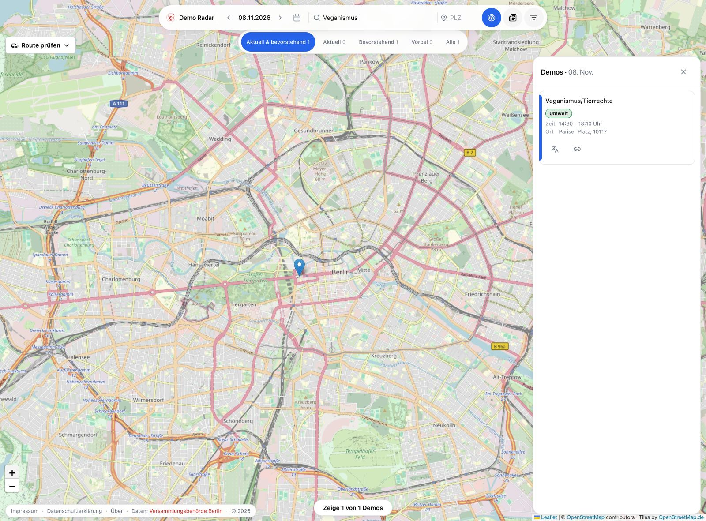

# Demo Radar

**Making public information useful in everyday life.**

Demo Radar turns Berlin's public demonstration records into a searchable map.
It helps residents and visitors explore causes, find gatherings, and understand
their times, locations and reported routes. People can use that information to
decide where they want to participate and which areas they would rather avoid.

**[Explore the live application](https://demo-radar.com)** ·
**[Read the DemoLogic project](https://github.com/demo-radar/demo-radar-logic)** ·
**[See the architecture](docs/architecture.md)**

*The public application, captured on 7 November 2026 with 8 November selected and the topic filter applied.
Open the live map to explore current records.*

Map data © [OpenStreetMap contributors](https://www.openstreetmap.org/copyright);
tiles by [OpenStreetMap.de](https://www.openstreetmap.de/).
Assembly records: [Berlin's assembly authority](https://www.berlin.de/polizei/service/versammlungsbehoerde/versammlungen-aufzuege/).

## Why I built it

Public records can be available without being easy to use. A long list of
assembly titles and addresses is hard to explore, especially when a slogan
needs context or a route is described as text.

I built Demo Radar to make that information easier to navigate. The project
also revealed work behind the map: checking locations, repairing routes,
understanding slogans and choosing consistent topic tags. That became the
starting point for DemoLogic, the AI research project and service alongside
the application.

## What the application does

| Area | Capability |
| --- | --- |
| Discover events | Search and filter demonstrations by date and topic on a map and in a list. |
| Understand locations | Show assembly points, clustered markers and available route geometry. |
| Read across languages | Offer German/English interface text and DeepL translations of titles and daily briefings. |
| Explore topics | Show saved topic tags, with AI suggestions subject to staff approval. |
| Read a daily AI briefing | Get a reviewed German/English overview of the selected day's demonstrations, main themes and a featured event. |
| Maintain the information | Give authorized staff tools to inspect source records, review suggestions and correct locations or routes. |

## The daily AI briefing

The newspaper button in the map's top bar opens a short briefing for the
selected day. It brings together the number of demonstrations in the saved
feed, their main themes and an event in focus. A **Getting around** section
highlights available route information to help readers orient themselves.

DemoLogic drafts the briefing in German from the day's stored public records.
Demo Radar translates it into English with DeepL. An admin reviews both
versions and can edit the text before publication. Readers see the saved,
published briefing, clearly labeled as AI-generated and reviewed, or AI-assisted
and edited. Opening it does not trigger another model call.

## Where DemoLogic fits

**DemoLogic — Figuring out what Berlin's demos have to say, one slogan at a time.**

DemoLogic's research compares rules, classical text classifiers, neural language
models and hosted language models using reviewed demonstration slogans. It
measures how often suggestions are correct, which relevant topics they miss,
and how often a method can offer a suggestion. The
[research methodology](https://github.com/demo-radar/demo-radar-logic/blob/main/docs/methodology.md)
explains the comparisons and their limits.

The service suggests topic tags and drafts daily briefings. Demo Radar saves
the results and provides the staff review and publication workflow. Eligible
saved answers and explicitly approved tagging rules can be reused for recurring
events. Browsing approved content does not require a new model call.

## Engineering behind the map

- **Turning text into geography:** interpret addresses and route descriptions,
  use mapping services, and provide a correction workflow for uncertain results.
- **Keeping maps readable:** cluster points, reveal route detail at useful zoom
  levels, and distinguish overlapping paths.
- **Making AI reviewable:** save suggestions before publication, retain review
  decisions, and reuse eligible work instead of repeatedly asking a model.
- **Handling uncertain failures:** check for a saved answer after a connection
  problem and require an explicit recovery decision when the outcome is unknown.

The [architecture overview](docs/architecture.md) explains the data pipeline,
service boundaries and the reasons behind these choices.

## Data and interpretation

Demo Radar is an independent project. It uses demonstration records published
by Berlin's assembly authority; it is not an official authority channel.
Records and routes can change or contain errors. Topic tags describe the
subject of a demonstration; claims in slogans remain the organizers' claims.
Reported routes do not confirm road closures or safety conditions.

## What's next

I want to learn from residents and civic organizations, evaluate usability and
accessibility, measure the staff effort needed to review suggestions, and
develop the mobile clients. Potential travel-disruption information and
expansion to other cities are longer-term directions.

## Other projects

Other websites and apps also help people discover demonstrations and make
civic information more visible. I appreciate the people building and
maintaining these services.

Demo Radar is an independent project and is not affiliated with those services.
My approach brings map-based discovery, route visualization, multilingual
access, reviewed topic tags and daily AI briefings together in one application.

## About this repository

This repository contains Demo Radar's project overview and architecture.
The application runs in Docker on Hetzner, with Cloudflare Tunnel as its public
entry point. Application source and deployment configuration stay in a private
Gogs repository; the [DemoLogic source](https://github.com/demo-radar/demo-radar-logic)
is public.

**Author: Roy Grossman.** Copyright © 2026 Roy Grossman. All rights reserved
for the original documentation and diagrams. See [copyright and permissions](COPYRIGHT.md).
Third-party services and source material retain their own rights.
