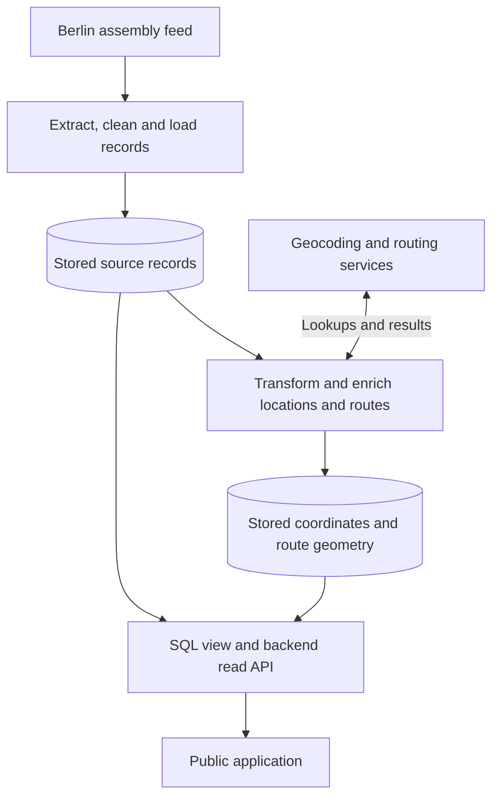
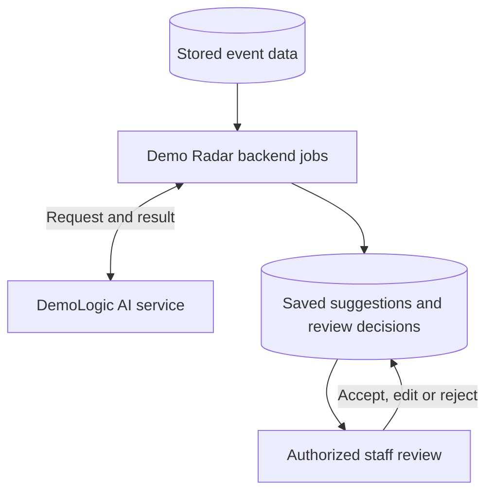

# How Demo Radar fits together

Demo Radar separates the frontend, application backend and AI inference.
The backend owns the event data and staff workflows. DemoLogic provides AI
inference through an API. The frontend displays saved information.

## From public records to the map

The data pipeline runs in **batches**: each import fetches the current assembly
feed, saves changes, then processes locations and routes.

The two storage boxes are groups of tables in the **same PostgreSQL/PostGIS
operational database**. Source records retain the imported event fields;
separate tables hold geocoding results and routes. The `demos_v` SQL view joins
those records for the read API. The public application combines the map,
event list and published daily briefing. Redis caches API responses.

Import performs light field cleanup before saving records: **extract,
transform, load (ETL)**. Geocoding and route building are separate **post-load
enrichment** stages. Backend workers read the saved records, resolve their
locations and routes, and write those results back to the operational database.

Keeping import and enrichment separate means a delayed mapping service does
not prevent source updates from being saved. Workers retain results and retry
state, and staff can correct locations and routes.

### What the data terms mean here

| Term | Role in Demo Radar |
| --- | --- |
| Batch ingestion | Fetch and process a set of assembly records in one import cycle. |
| ETL | Extract the feed, clean and map its fields, and load changed source records. |
| Transformation and enrichment | Normalize addresses, resolve coordinates and turn route text into geometry. |
| Operational database | Support the running application: events, geometry, corrections, AI results and review decisions. |
| Read model | The SQL view combines stored source and geographic records into the event representation used by the API. |

These stages keep the public map and staff workflow up to date.

## Where AI fits

Demo Radar prepares AI requests from stored events and saves the returned work
for review. DemoLogic does not query the application database directly.

- **Topic tagging:** standard requests contain an event ID and title. Staff
  review the suggested tags before publication.
- **Daily briefings:** requests contain a selected snapshot of titles, times,
  location and route text, and approved tags. Computed map geometry is not
  part of that snapshot. Staff can edit the draft before publishing it.
- **Additional context:** the manual Gem workflow can include more event
  information when staff need it.

DeepL handles translations in Demo Radar, separately from generation in
DemoLogic. The read API serves approved tags and published briefings from
storage; opening the public application does not trigger inference.

Saved answers can be reused when eligible. Staff can also explicitly approve
tag reuse for future matching events. This reduces repeated model calls while
keeping each dated demonstration as a separate event.

If a model request times out, recovery first checks for the original saved
answer. An unknown outcome pauses new inference until an operator records a
recovery decision, avoiding an automatic resend of potentially completed work.

## Service boundaries

| Part | Responsibility |
| --- | --- |
| Frontend | React, TypeScript and Leaflet render the public map, list and briefing, and the staff interface. |
| Backend | Import and enrich records, serve the API, enforce staff permissions, manage corrections, request AI work and save review decisions. |
| DemoLogic | Validate inference requests, call the configured model provider, and retain results, usage and recovery state in a persistent journal. |

Backend requests to DemoLogic use a service token. Provider credentials stay on
the server. Keeping AI behind its own API lets its models and instructions
evolve without putting inference into the public page-loading path.

The public [DemoLogic project](https://github.com/demo-radar/demo-radar-logic)
contains its implementation, research methods, results and limitations.

## Hosting and operations

| Component | Role |
| --- | --- |
| Hetzner | Application hosting; model inference uses the configured provider service. |
| Cloudflare Tunnel | Public entry point to the application. |
| Docker | Run the application and supporting services in containers. |
| PostgreSQL/PostGIS | Persistent application records and geospatial data. |
| Redis | Cache API responses. |
| DeepL | Translate titles and daily briefings. |
| Prometheus and Grafana | Track service health, jobs, inference usage and operational outcomes. |
| Gogs | Host the private application repository. |
| GitHub | Host this project overview and the separate public DemoLogic repository. |

Private settings, server addresses, credentials and operator commands stay
outside this overview. Operational monitoring helps run the service; the
DemoLogic research evaluates the quality of its suggestions.
