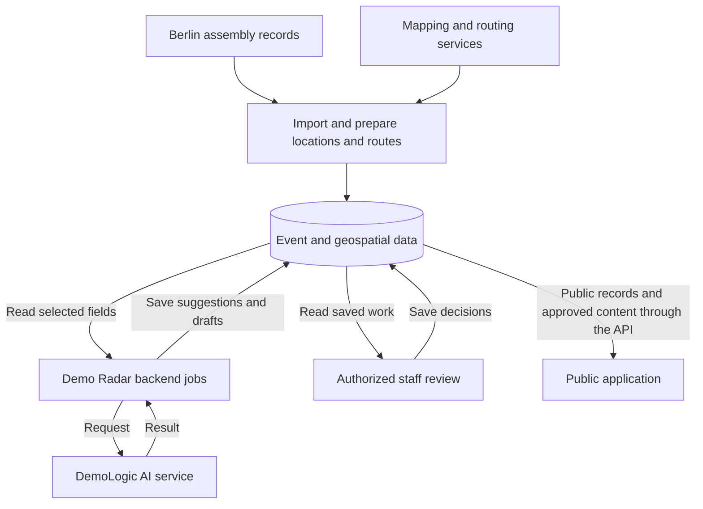

# How Demo Radar fits together

> Draft for owner review. This describes the application; it is not a runnable
> architecture included in this repository or a fresh audit of production.

## How the application uses stored event data

The backend imports public assembly records and prepares their locations and
available routes. PostgreSQL/PostGIS stores the event and geospatial data;
Redis provides caching. The application database also holds saved suggestions,
summary drafts and review decisions. React, TypeScript and Leaflet provide the
public application: its map, list and published daily briefing. A read API
serves those screens. Staff actions require authorization.

## AI assists a review workflow

1. Demo Radar's backend jobs read eligible stored events and prepare a request.
2. DemoLogic calls its configured provider and retains results and usage state.
3. Demo Radar saves the suggestion or draft for staff review.
4. Staff accept, edit or reject tag suggestions, or review a daily briefing.
5. Approved content is read from stored data. Eligible saved answers and
   explicitly approved recurring-event rules can avoid new inference.

DemoLogic does not query the application database directly. Standard tagging
receives an event ID and title. Daily briefings receive a selected snapshot of
titles, times, location and route text, and approved tags. The daily snapshot
does not require map coordinates or computed route geometry. Explicit Gem
workflows can provide additional event context.

Tags and daily briefings have separate review controls. The backend includes
recorded human edits to finished private briefing drafts before publication.
DeepL translation is handled by Demo Radar and is distinct from the model
generation request. Availability of features follows the deployed release.

If a request times out, the remote outcome can be unknown. Recovery first checks
for the original saved answer. An unresolved outcome requires an explicit
operator decision rather than an unconditional resend. This reduces ambiguity;
it does not guarantee provider availability.

## Controls around the workflow

| Responsibility | Where it belongs |
| --- | --- |
| Staff identity and permissions | Demo Radar checks the authenticated session and required role/capability on protected backend actions. |
| Service access and secrets | Backend-to-DemoLogic requests use a service token. Provider keys stay in private server settings, outside browser code and this repository. |
| Model configuration | DemoLogic exposes an authenticated task/profile catalog. Each job retains the selected configuration identity. |
| Recovery and spending | The backend saves requests and outcomes. DemoLogic retains admission, usage, spending and uncertain-outcome state in its persistent journal. |
| Operations | Prometheus and Grafana show operational measurements. They are distinct from research evaluation and do not establish model correctness. |

These are application responsibilities, not a claim that Demo Radar is a
general-purpose enterprise AI platform. The [engineering decisions](engineering-decisions.md)
explain alternatives, evaluation, cost accounting, AI risks and remaining gaps.

## Hosting at a glance

| Part | Documented role |
| --- | --- |
| Hetzner | Cloud infrastructure for the application; configured model inference is a separate provider service. |
| Cloudflare | Public entry through the documented Tunnel setup. |
| Docker | Containerized application and supporting services. |
| PostgreSQL/PostGIS and Redis | Persistent application/geospatial data and caching. |
| DemoLogic | Separate AI service with request validation, saved results and recovery state. |
| DeepL | Translation of demonstration titles and daily briefings. |
| Prometheus and Grafana | Operational metrics and dashboards; no public dashboard is promised here. |
| Gogs | Private application development repository. |
| GitHub | Project documentation and the separately published DemoLogic source. |

This is a provider/component-level explanation. Server addresses, credentials,
private access paths and deployment or recovery commands are not needed to
understand the project and are excluded. Hosting details should be confirmed
by the owner before publication; this draft makes no uptime, contractual
data-residency or security-certification claim.

## What stays outside this repository

- Application and staff-workflow source code.
- Runtime settings, credentials, operator runbooks and private addresses.
- Event exports, review notes, account records and private research inputs.
- The full application Git history and the previous synthetic code showcase.

The public [DemoLogic project](https://github.com/demo-radar/demo-radar-logic)
documents its own implementation, experiments and limitations. Its source
licence applies there; it does not licence the private Demo Radar application.
