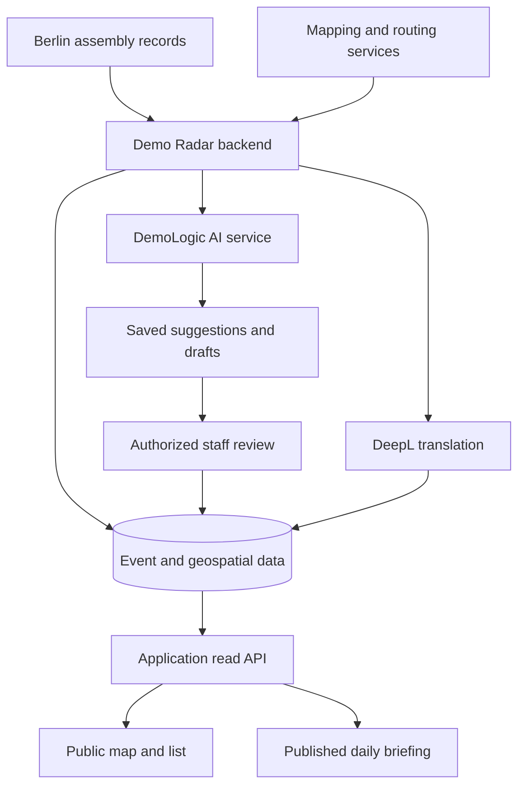

# How Demo Radar fits together

> Draft for owner review. This describes the application; it is not a runnable
> architecture included in this repository or a fresh audit of production.

## From public records to a useful map

The backend imports public assembly records and prepares their locations and
available routes. PostgreSQL/PostGIS stores the event and geospatial data;
Redis provides caching. React, TypeScript and Leaflet provide the browser
interface. A public read API serves the application; staff actions require
authorization. Private source code does not mean every application endpoint
is inaccessible to the public.

## AI assists a review workflow

1. Demo Radar selects eligible work and sends a request to DemoLogic.
2. DemoLogic calls its configured provider and retains results and usage state.
3. Demo Radar saves the suggestion or draft for staff review.
4. Staff accept, edit or reject tag suggestions, or review a daily briefing.
5. Approved content is read from stored data. Eligible saved answers and
   explicitly approved recurring-event rules can avoid new inference.

Tags and daily briefings have different review controls. This does not claim
that daily-briefing text already has an editing feature. DeepL translation is
handled by Demo Radar and is distinct from the model generation request.

If a request times out, the remote outcome can be unknown. Recovery first checks
for the original saved answer. An unresolved outcome requires an explicit
operator decision rather than an unconditional resend. This reduces ambiguity;
it does not guarantee provider availability.

## Hosting at a glance

| Part | Documented role |
| --- | --- |
| Hetzner | Cloud infrastructure for the application; configured model inference is a separate provider service. |
| Cloudflare | Public entry through the documented Tunnel setup. |
| Docker | Containerized application and supporting services. |
| PostgreSQL/PostGIS and Redis | Persistent application/geospatial data and caching. |
| DemoLogic | Separate AI service with request validation, saved results and recovery state. |
| DeepL | Translation of demonstration titles and daily briefings. |
| Prometheus and Grafana | Operational metrics and dashboards; no public dashboard is promised here. |
| Gogs | Private application development repository. |
| GitHub | Project documentation and the separately published DemoLogic source. |

This is a provider/component-level explanation. Server addresses, credentials,
private access paths and deployment or recovery commands are not needed to
understand the project and are excluded. Hosting details should be confirmed
by the owner before publication; this draft makes no uptime, contractual
data-residency or security-certification claim.

## What stays outside this repository

- Application and staff-workflow source code.
- Runtime settings, credentials, operator runbooks and private addresses.
- Event exports, review notes, account records and private research inputs.
- The full application Git history and the previous synthetic code showcase.

The public [DemoLogic project](https://github.com/demo-radar/demo-radar-logic)
documents its own implementation, experiments and limitations. Its source
licence applies there; it does not licence the private Demo Radar application.
